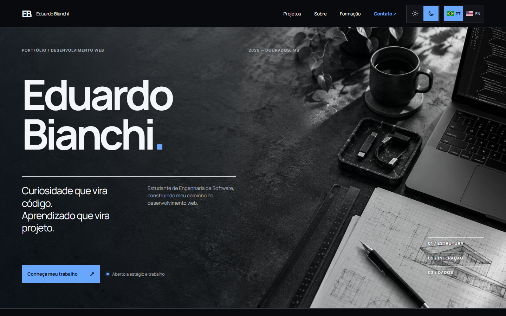

# Eduardo Bianchi · Portfólio

Portfólio pessoal de **Eduardo Pires Bianchi**, estudante de Engenharia de Software em Dourados, MS. Reúne projetos de interfaces, uma aplicação de suporte e experiências interativas.

**Acesse:** [www.eduardopbianchi.com.br](https://www.eduardopbianchi.com.br/)



## Conteúdo

- Site estático em HTML, CSS e JavaScript, responsivo, em português e inglês, com temas claro e escuro.
- Navegação por seções e acesso rápido com `Ctrl+K`/`⌘K`.
- Animações de entrada em CSS, faixa de ferramentas em movimento quando visível e suporte à preferência por movimento reduzido. A página principal não carrega GSAP nem Canvas.
- **Nexo Desk**, **Entre Cenas**, **Forma**, **Price Cards** e **FIO / tech** apresentados com o mesmo peso visual, índice navegável e capturas reais. Um controle alterna as capturas entre desktop e celular.
- Demonstrações públicas dos cinco projetos, além de versões locais de **Entre Cenas**, **Forma** e **Price Cards**.
- Contato por e-mail, telefone e botão que abre uma conversa no WhatsApp.
- Currículo em PDF disponível na seção Sobre.

## Projetos

| Projeto | Sobre | Tecnologias |
| --- | --- | --- |
| [**Nexo Desk**](https://nexo-desk-pi.vercel.app/) | Sistema de suporte com fila e quadro de chamados, filtros, indicadores, histórico, notas internas e ações em lote com opção de desfazer. A demonstração pública usa dados fictícios no navegador; não atende chamados reais nem inclui a API ou o banco. | HTML, CSS, JavaScript, GSAP, localStorage na demonstração, Node.js, Express, SQLite |
| [**Entre Cenas**](https://entrecenas-blond.vercel.app/) | Diário de cinema para descobrir filmes, organizar uma lista pessoal e registrar avaliações e anotações. O catálogo TMDb é opcional e pede um token no navegador; a coleção de demonstração funciona sem ele. | HTML, CSS, JavaScript, GSAP, localStorage, TMDb opcional |
| [**Forma**](https://forma-nine-wheat.vercel.app/#inicio) | Página de contato com temas claro e escuro, validação acessível, assunto e orçamento opcionais. A demonstração não envia mensagens; o envio real depende de um serviço configurado. | HTML, CSS, JavaScript, GSAP |
| [**Price Cards**](https://pricecards.vercel.app/#inicio) | Estudo responsivo de planos de hospedagem com comparação interativa, resumos e indicação por quantidade de sites e necessidade de e-mail personalizado. Preços apenas demonstrativos. | HTML, CSS, JavaScript |
| [**FIO / tech**](https://fiotech-six.vercel.app/) | Loja conceitual de eletrônicos e informática com catálogo, filtros, comparação de até três itens, favoritos e questionário de setup baseado em regras explicadas. Produtos e preços fictícios; sem compra real. | React, TypeScript, Vite, CSS, GSAP, localStorage |

As demonstrações de Entre Cenas, Forma e Price Cards também estão incluídas em `projetos/` e funcionam sem instalar dependências. Nexo Desk e FIO / tech são apresentados com capturas reais; suas aplicações não fazem parte deste repositório. Os cinco endereços públicos estão configurados em `script.js`.

## Movimento e desempenho

As entradas durante a rolagem usam `IntersectionObserver` e animam apenas opacidade e posição. Nos projetos, a entrada afeta o texto; as capturas não são animadas como um bloco grande. A navbar e o índice de projetos mantêm a posição fixa durante a leitura sem aplicar desfoque ao conteúdo que passa atrás deles. O indicador de progresso é atualizado com `requestAnimationFrame`, no máximo uma vez por quadro. A faixa de ferramentas pausa fora da área visível.

Essas escolhas reduzem o trabalho de renderização durante a rolagem. Não há uma medição de FPS publicada neste repositório; o resultado pode variar conforme o aparelho e o navegador.

A abertura usa WebP de 800 px no celular (20 KB) e uma versão de 1672 px no desktop (64 KB), pré-carregadas por breakpoint. A Raleway é servida em WOFF2 pelo próprio domínio, com `font-display: swap`. O CSS inicial fica no HTML e a folha completa carrega por preload, com alternativa para JavaScript desativado.

Após editar `style.css`, atualize o trecho inicial com `node tools/build_critical_css.cjs`. Esse utilitário usa apenas Node.js e mantém a ordem das regras da folha original. As otimizações foram conferidas localmente; não representam uma nova medição de LCP em 4G. Repita o PageSpeed Insights após publicar.

## Executar localmente

O site é estático e não precisa de compilação nem instalação de pacotes. Na pasta do repositório, inicie um servidor HTTP local:

```bash
python -m http.server 8080
```

No Windows, também é possível usar `py -3 -m http.server 8080`. Acesse `http://localhost:8080` no navegador. Para conferir uma demonstração diretamente, abra `projetos/entre-cenas/`, `projetos/forma/` ou `projetos/price-cards/`.

## Busca e compartilhamento

O domínio canônico é `https://www.eduardopbianchi.com.br/`. O título, a descrição e as tags Open Graph/Twitter estão no HTML inicial, disponíveis sem executar JavaScript. A capa pública de compartilhamento é `/og.jpg`, em JPEG de 1200 × 630 pixels (72 KB); a cópia de origem permanece em `assets/portfolio-social-v1.jpg`. O briefing da arte está em `assets/portfolio-social-brief.md`. As demonstrações locais e a página de privacidade também têm metadados de compartilhamento.

`robots.txt` permite o rastreamento e informa o endereço de `sitemap.xml`. O sitemap lista a página principal, as três demonstrações locais, a política de privacidade e os termos de uso. As seções com `#` fazem parte da mesma página; as demonstrações externas têm seus próprios domínios. O HTML inicial inclui JSON-LD de `Person`, `WebSite` e `ProfilePage`, com informações presentes no portfólio.

Após publicar estas alterações na Vercel, confira `/robots.txt`, `/sitemap.xml` e `/og.jpg` no domínio oficial. No Google Search Console, envie `https://www.eduardopbianchi.com.br/sitemap.xml`. A indexação e a atualização de prévias dependem dos serviços; o WhatsApp pode manter uma imagem anterior em cache.

## Privacidade e medição

`/privacidade/` identifica Eduardo Pires Bianchi como pessoa física responsável e informa o contato profissional. Foi adotado, por escolha do responsável, o prazo máximo de 12 meses após a última conversa para contatos encerrados. Essa revisão/exclusão acontece nas contas de e-mail e WhatsApp; o site não acessa essas caixas nem exclui mensagens automaticamente.

`assets/privacy.js` oferece aceitar/recusar e guarda a escolha no navegador por até 180 dias. A versão atual da escolha (`portfolio-privacy-v2`) abrange o Pixel da Meta e o Google Analytics; escolhas da versão anterior não são reaproveitadas. O visitante pode reabrir o controle na política. Ao recusar, o código bloqueia os novos disparos de medição e solicita a remoção dos cookies de primeira parte conhecidos da Meta e do Analytics. A faixa respeita o tema e o idioma do portfólio; a política e os termos estão em português. As fontes locais dispensam a conexão ao Google Fonts na página principal.

O Pixel da Meta `1321323833385070` está centralizado em `assets/meta-pixel.js`. Ele só inicia depois de aceitar a medição e apenas nos hosts `www.eduardopbianchi.com.br` e `eduardopbianchi.com.br`. Registra um `PageView` por documento e `Contact` nos cliques em `wa.me` ou `api.whatsapp.com`. Âncoras internas não contam como novas páginas. A biblioteca externa carrega com `async`, após o evento `load`; o contato continua funcionando se ela for bloqueada. Localhost e prévias da Vercel não enviam eventos de produção.

O GA4 `G-M36GTQ5ZQ3` está centralizado em `assets/analytics.js`, com a mesma restrição de domínio e consentimento do Pixel. `gtag.js` só carrega com `async` depois de aceitar e do evento `load`. O código envia um `page_view` por documento (com o pageview automático de configuração desativado) e `generate_lead` no clique do WhatsApp. O evento indica intenção de contato, não confirma uma mensagem enviada. O único parâmetro personalizado é `contact_method: whatsapp`, sem telefone, e-mail ou texto da mensagem. Sinais do Google, personalização e armazenamento para anúncios não são habilitados pela integração.

A medição otimizada foi habilitada pelo responsável no fluxo GA4. Os eventos automáticos controlados pelo painel são adicionais aos eventos personalizados. Ao configurar mudanças de histórico no GA4, lembre que as âncoras de seção deste portfólio não são novas páginas.

Para conferir após o deploy, aceite a medição no domínio oficial e use "Testar eventos" no Gerenciador de Eventos da Meta e "Tempo real" no Analytics. Clique no WhatsApp e confira `Contact` e `generate_lead`. No GA4, marque `generate_lead` como evento principal se quiser utilizá-lo como conversão. A validação local usa eventos simulados e não confirma recebimento nos serviços. Execute `node tools/check_tracking.cjs` para repetir os testes de consentimento, revogação, eventos e exclusão de prévias sem enviar dados reais.

`/termos/` reflete o uso confirmado: portfólio gratuito e demonstrações, sem compra ou contratação pelo site. Antes de oferecer contratação direta, será necessário revisar os termos, a identificação e as condições comerciais. Os rodapés atuais identificam o responsável com nome, cidade e e-mail profissional; nenhum CPF/CNPJ foi informado ou publicado.

O andamento dos onze itens do relatório está em `docs/raio-x.md`.

## Estrutura

- `index.html`, `style.css`, `script.js`, `language.js`, `effects.js`: página, estilos, interações, traduções e faixa de ferramentas.
- `assets/`: capturas reais, artes originais, fontes com suas licenças e currículo público.
- `assets/vendor/`: cópias locais do GSAP e ScrollTrigger usadas pelas demonstrações incluídas, com avisos de licença preservados.
- `projetos/`: demonstrações autocontidas dos projetos incluídos.
- `tools/build_resume.py`: código-fonte do currículo PDF. Requer Python, ReportLab e fontes Arial disponíveis no ambiente Windows usado para gerá-lo.
- `DESIGN.md`: notas sobre a direção visual do portfólio.

## Informações públicas

O portfólio exibe nome, cidade, e-mail, LinkedIn e telefone para contato profissional. O botão de WhatsApp abre uma conversa com o mesmo número exibido na página; nenhuma mensagem é enviada pelo portfólio. O PDF público mantém os dados que já constam nele. A configuração de envio do Forma está vazia por padrão: nenhum formulário envia dados até que um serviço seja configurado pelo responsável pelo deploy. Entre Cenas solicita o token TMDb ao visitante e o guarda apenas na sessão do navegador.

O README, o código e os recursos deste repositório não precisam de arquivos `.env`, tokens, banco de dados local ou credenciais. Não adicione esses dados ao publicar. A pasta `tmp/` é local e fica ignorada pelo Git.

## Licenças

Os arquivos de fonte e as cópias do GSAP incluem seus avisos de licença. Este repositório não define uma licença geral de reutilização para o portfólio, currículo, imagens e código. Peça autorização ao autor antes de reutilizar esses materiais.
